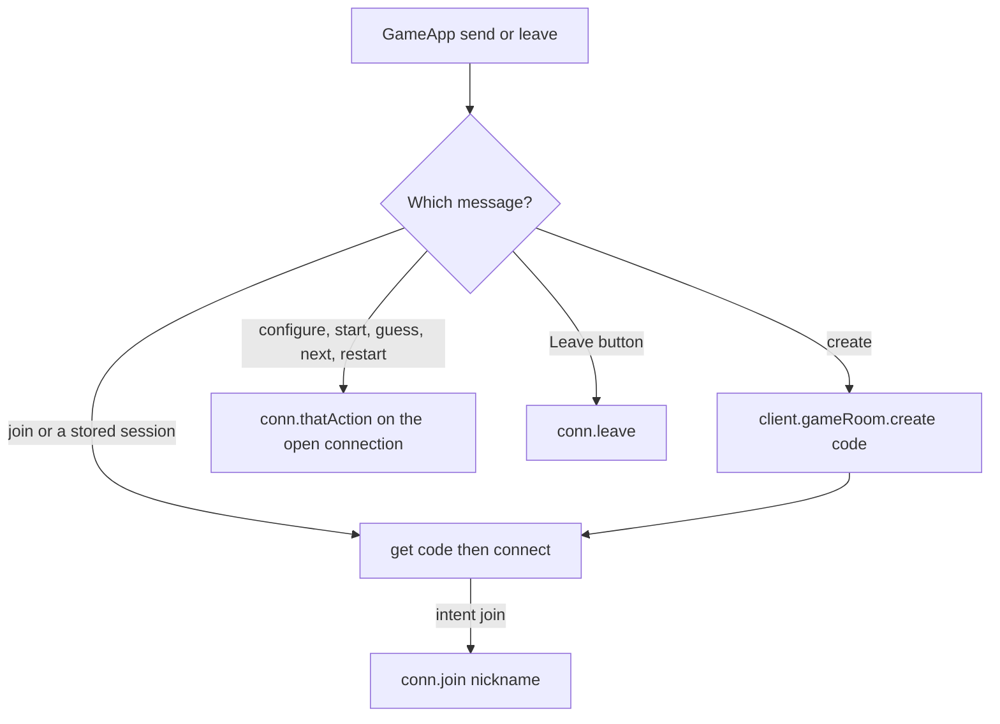

# How useRoom calls Rivet

`GameApp` still calls `send({ type: 'guess', text })` and the other `ClientMessage` values. `useRoom` does not write those objects onto a WebSocket. It turns each one into a different Rivet call.

There are three kinds of call.



`createClient` in `src/rivet/browser-client.ts` returns a client whose `gameRoom` property matches the actor name in `src/rivet/registry.ts`. Methods on that handle are Rivet actions. They are not HTTP routes we defined.

## Create is not an action

Hosting and solo play send `{ type: 'create' }`. `hostRoom` mints a `playerId` and a 4-character code, then:

```ts
await client.gameRoom.create([code], { input })
```

`create([code])` asks Rivet for a new actor with that key. If the key exists, `isTakenCode` is true and the loop tries another code, up to 20 times. The input (nickname, playlist, clip, rounds, mode, answer) is what `createState` in `game-room.ts` reads. The host is already seated inside that new room.

After create succeeds, the hook stores `{ code, playerId }` and connects with `intent: 'resume'`. Resume is legal because `createRoom` already put the host in the player list. There is no `create` action on the actor.

## Join and resume are a connection, then maybe one action

`connectCurrent` does this for every open, including the host after create:

1. `client.gameRoom.get([code]).resolve()` checks the actor exists. `not_found` forgets the session and shows "No room with that code".
2. `.connect({ playerId, intent })` opens the socket. `intent` is `'join'` or `'resume'`.
3. The actor's `onBeforeConnect` rejects a resume whose `playerId` is not in the room.
4. If this open was a new join, `await conn.join(nickname)` runs after `conn.ready`. That is the `join` action. It calls `joinRoom`.

A join of a code already in `sessionStorage` skips the new id and connects with `resume` instead. After the first snapshot, later reconnects also use `resume`, so `join` is not called again.

The actor then sends a `snapshot` event on that connection only. `useRoom` stores `payload.view` and `GameApp` renders it.

## Play clicks are methods on the connection

`configure`, `start`, `guess`, `next`, and `restart` go through `replayOf`, then `runReplay`.

`replayOf` copies the fields and adds a `msgId` (`makeId()`). `runReplay` is a switch on that type:

| `send(...)` | Rivet call |
| --- | --- |
| `configure` | `conn.configure(msgId, playlistId, clipSeconds, roundCount, answer)` |
| `start` | `conn.start(msgId, avoidTrackIds)` |
| `guess` | `conn.guess(msgId, text)` |
| `next` | `conn.next(msgId, roundNumber)` |
| `restart` | `conn.restart(msgId)` |

Those names are the actor's `actions` in `src/rivet/game-room.ts`. Rivet delivers the arguments to that function, with the caller taken from the connection (`c.conn.state.playerId`), not from the message body.

If the socket is not `connected`, `runReplay` is skipped and the command is kept in `lastCommand`. The next time the status is `connected`, the same object is sent again, same `msgId`. The actor remembers the last 32 ids per player. A repeat sends the current view and does not apply the guess again.

`{ type: 'resume' }` and `{ type: 'leave' }` inside `send` do nothing. Resume is the connect intent above. Leave is the `leave()` callback, used by the Leave button: `conn.leave()`, then dispose. `leave` is an actor action. It removes the seat and, if the room is empty, destroys the actor.

## What comes back

The actor does not return the screen from the action. It emits events on the connection:

| Event | Hook effect |
| --- | --- |
| `snapshot` | Replace `view`. This is the screen. |
| `error` | Show `message`. "No room with that code" also forgets the session. |
| `left` | Clear the view and the saved session. |

A dropped socket sets `connected` false. `GameApp` keeps the last `view` and shows "Reconnecting…". The session in `sessionStorage` stays, so the next connect is a resume of the same seat.
