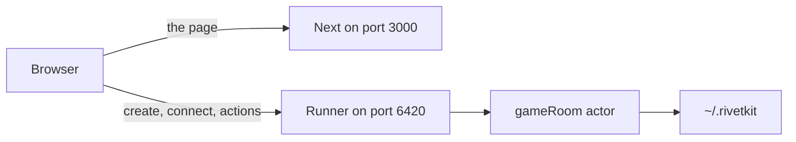
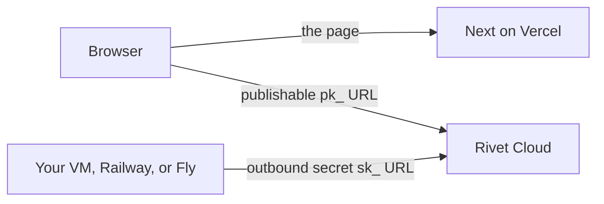
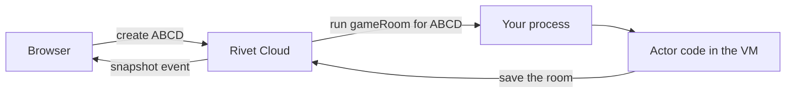

# How a room runs

One room is one Rivet actor. The 4-character code is the actor's key. The Next.js site only serves the page. A separate Node process runs the actor. Rivet stores the room, so a refresh does not wipe it.

The game rules still live in `src/game/room.ts`. The actor calls those functions. It does not reimplement scoring, guesses, or the phase machine. The click-by-click sequence is in [sequences.md](sequences.md).

## Locally there is no Rivet Cloud

`npm run dev` starts two processes.

Next serves the UI and, in fixture mode, the tone at `/api/fixture-tone`. The browser's Rivet client talks to `http://127.0.0.1:6420`. That process is both the engine and the place the actor code runs. Room state is a file under `~/.rivetkit`. No account and no `RIVET_ENDPOINT` are required.

`dev.ts` starts the runner first and waits until port 6420 accepts a connection. Then it starts Next. If Next came up first, the page would load and every create would fail.

## In production Rivet Cloud sits in the middle

The browser never opens a socket to your machine. It talks to Rivet Cloud with the publishable URL (`pk_`). That URL is safe to ship in the Next bundle as `NEXT_PUBLIC_RIVET_ENDPOINT`.

Your process does the opposite of a public server. On boot, `runner.ts` calls `registry.start()`. With `RIVET_ENDPOINT` set to the secret URL (`sk_`), that process dials out to Rivet Cloud and waits. You do not register a public URL for it. Outbound HTTPS to Rivet and to iTunes is enough.

Create, join, and guess arrive at Rivet Cloud first. Cloud decides which connected runner should run that key, and sends the call to your process. The actor function runs there. The saved room lives in Rivet, not in the VM's memory. The snapshot event travels back through Cloud to the browser that is connected to that room.

A guess from a second browser uses the same key, so Cloud delivers it to the same actor. That is the thing the old in-memory `Map` could not do once Vercel put two people on two instances.

iTunes lookups also happen inside the actor, on your machine, during `start`. The Next app does not call iTunes.

## What survives what

| Event | Room |
| --- | --- |
| Socket drops | Stays. The player is marked away. |
| VM restarts | Stays in Rivet. The next connect wakes the actor on a runner. |
| Last player presses Leave | `c.destroy()`. The next `get` fails. |
| Everyone disconnected for 6 hours | `_reap` destroys it. |
| Someone connects again | The 6-hour timer is reset. |

The round timer is `c.schedule.after` on the actor. It still fires when no browser is connected. `onWake` reveals a round that ended while the process was down. `run` arms the timers after that, because Rivet accepts the browser socket as soon as the actor is marked started and only waits 5 seconds for the socket to finish opening.

## Where the code lives

| File | Role |
| --- | --- |
| `src/rivet/registry.ts` | Registers the one actor type, `gameRoom`. |
| `src/rivet/game-room.ts` | The actor. Actions, timer, presence, destroy. |
| `src/rivet/types.ts` | Saved state, connection params, and the browser's picture of the client. |
| `src/rivet/errors.ts` | "No room with that code", and the collision check used when two hosts mint the same code. |
| `src/rivet/browser-client.ts` | `createClient` pointed at the public endpoint. |
| `src/components/useRoom.ts` | The only browser caller. See [actions.md](actions.md). |
| `runner.ts` | `registry.start()` for local dev and for the VM. |
| `dev.ts` | Runner, then Next. |
| `Dockerfile` | Node 22 Debian image that runs `runner.ts`. |
| `src/game/room.ts` | Unchanged game rules. |

`src/server/hub.ts`, `src/app/api/ws/route.ts`, and `server.ts` are gone. Those were the in-memory map, the Vercel socket route (`maxDuration` 300), and the custom server that held the socket open.

## Notes from review

**One missing-room sentence.** A code that was never created and a saved seat whose room is gone both surface as "No room with that code". The actor throws that from `onBeforeConnect` when a resume names a player who is not seated. A missing actor (`not_found`) is mapped to the same sentence in `explainConnectError`.

**Types.** Shared Rivet shapes live in `src/rivet/types.ts`. That includes the saved room, the socket params, and the browser client types.

**`next.config.ts`.** Removed. It only existed to mark the `ws` package external, and that package is gone. Next uses its defaults.

**`AGENTS.md`.** Next writes this file when `next dev` runs. The "breaking changes" paragraph is Next 16 telling an agent that this Next version differs from older Next. It is not about the room actor. Deleting the file makes the next dev run write it again.
