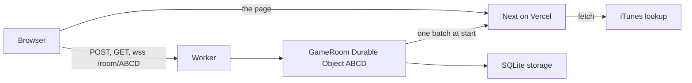

# How a room runs

One room is one Cloudflare Durable Object. The 4-character code is the object's name. The Next.js site serves the page and, in production, the preview lookup. A small Worker routes each request to the right room. The room is saved in the object's SQLite storage, so a refresh, an eviction or a deploy does not wipe it.

The game rules still live in `src/game/room.ts`. `RoomHost` (`src/cloudflare/room-host.ts`) calls them. It does not reimplement scoring, guesses, or the phase machine. The click-by-click sequence is in [sequences.md](sequences.md).

The Rivet backend is still in the repo as an alternate. See [architecture-rivet.md](architecture-rivet.md). Pick one with `NEXT_PUBLIC_ROOM_BACKEND` (`cloudflare` is the default).

## Pieces

- **Worker** (`worker/index.ts`, default export). Checks the origin, then forwards `/room/:code` to `env.GAME_ROOM.getByName(code)`. `GET /health` answers `{ ok: true }`.
- **`GameRoom`** (`worker/index.ts`). The Durable Object. It owns the WebSockets, storage and the alarm. It accepts sockets with the Hibernation API, so an idle room costs no duration.
- **`RoomHost`** (`src/cloudflare/room-host.ts`). One room's rules and bookkeeping, with no Cloudflare imports. The object hands it a small `RoomPlatform` (clock, sockets, save, alarm, wipe). This is what the unit tests drive.
- **`wire.ts`** (`src/cloudflare/wire.ts`). The JSON the browser sends. The server sends `ServerMessage` from `src/game/protocol.ts`.
- **Browser client** (`src/transport/cloudflare-client.ts`). Implements the same `SongClient` shape the Rivet client has, so `useRoom` is the same for both. The socket reconnects on its own with a 0.5 to 5 second backoff.

## Requests

| Browser does | Request |
| --- | --- |
| Host a room | `POST /room/ABCD` with the create input. `201`, or `409` when the code is taken. `400` for a bad nickname or playlist. |
| Check a room exists | `GET /room/ABCD`. `200`, or `404` "No room with that code". |
| Play | WebSocket `/room/ABCD?playerId=...&intent=join` or `resume`. |

Over the socket the browser sends `join`, `configure`, `start`, `guess`, `next`, `restart` and `leave`. The caller is the socket's `playerId`, never a field in the body. The room replies with `snapshot` (each socket gets its own view), `error` and `left`. A resume for a player who has no seat gets `error: No room with that code` and the socket closes.

## Timers: one alarm

A Durable Object has one alarm, so it covers two things. The alarm is set to the earlier of the round deadline (`room.roundEndsAt`, only while playing) and the idle reap time (`lastSeenAt` plus 6 hours).

- When it fires after the deadline, the round is revealed, even with nobody connected.
- When it fires for the reaper: if a socket is open or a player is marked present, `lastSeenAt` moves to now. Otherwise, past 6 hours idle, the room is destroyed (`deleteAll`).
- An alarm that fires early only re-arms. A stale one cannot reveal the wrong round, because the deadline is read from the room.
- The alarm is a billed write, so `RoomHost` only calls `setAlarm` when the target time changes. A guess does not.

## What survives what

| Event | Room |
| --- | --- |
| Socket drops | Stays. The player is marked away. The client reconnects. |
| Object evicted or Worker deployed | Stays in storage. The next connect loads it. On load, a round whose deadline passed is revealed, a stuck song load goes back to the lobby, and players with no socket are marked away. |
| Last player presses Leave | `deleteAll`. The next `GET` is a `404`. |
| Everyone disconnected for 6 hours | The alarm destroys it. |

## Where the code lives

| File | Role |
| --- | --- |
| `worker/index.ts` | Worker router and the `GameRoom` Durable Object. |
| `wrangler.jsonc` | Binding, SQLite migration, vars. `server-only` is aliased to an empty module. |
| `src/cloudflare/room-host.ts` | The room's logic over a `RoomPlatform`. |
| `src/cloudflare/wire.ts` | Browser to room messages and their parser. |
| `src/game/room-service.ts` | Create validation and `msgId` dedupe, shared with the Rivet actor. |
| `src/transport/` | `SongClient` type, the Cloudflare client, and `createRoomClient()` that picks the backend. |
| `src/server/previews.ts` | Preview lookup. Production posts one batch to `/api/preview-lookup`. Local and Rivet call Apple directly. |
| `dev.ts` | `wrangler dev` (or the Rivet runner), then Next. |
| `scripts/smoke-worker.mjs` | End-to-end check of a running Worker. |

## Choosing the backend

`NEXT_PUBLIC_ROOM_BACKEND` is read in the browser, so it is fixed when the site is built. `next.config.ts` defines it as `cloudflare` unless it is `rivet`. That makes the bundler drop `rivetkit` from the default build. A room lives only in the backend that created it. Changing the flag strands existing rooms.

## Local dev

`npm run dev` starts `wrangler dev` on port 8787, waits for it, then starts Next with `NEXT_PUBLIC_ROOM_WS_URL=ws://127.0.0.1:8787`. State is under `.wrangler/state` (git-ignored). No Cloudflare account or login is needed. `ROOM_BACKEND=rivet npm run dev` starts the Rivet runner instead.
